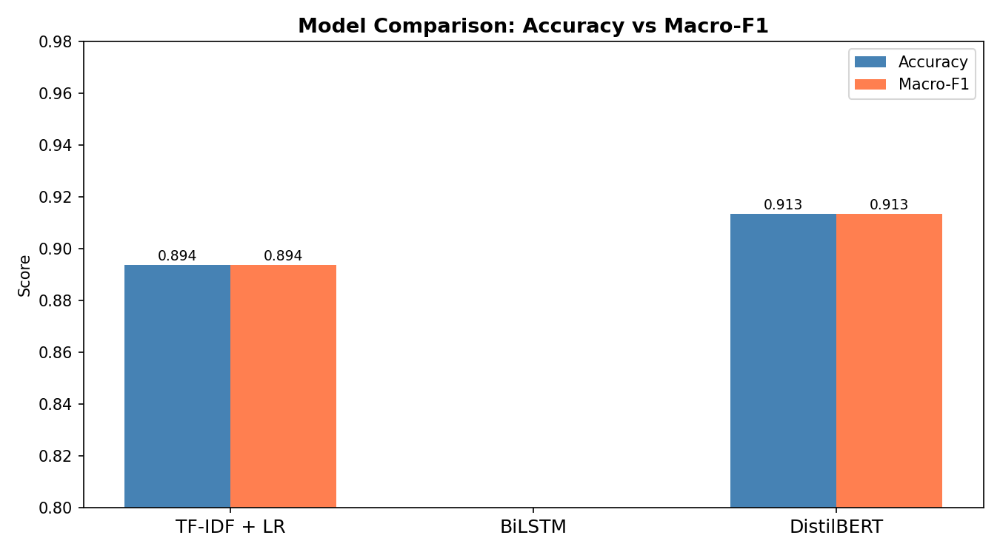
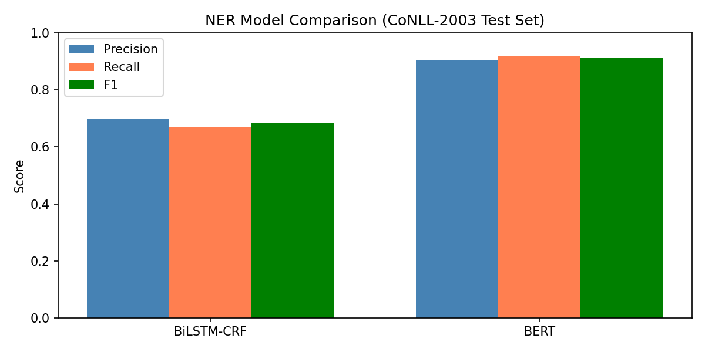
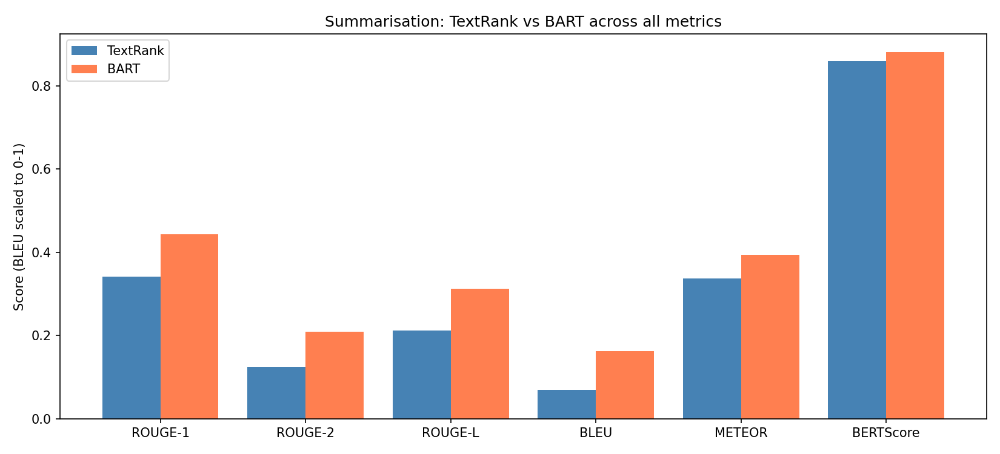
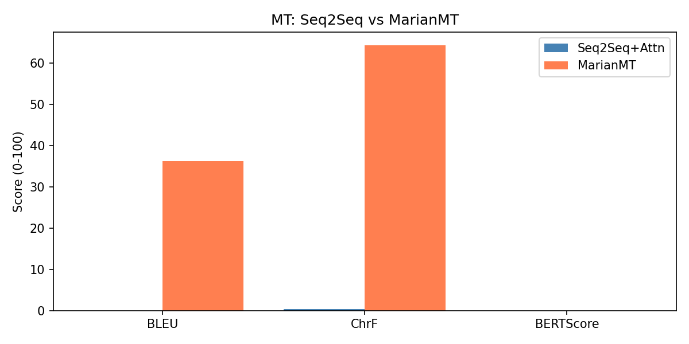
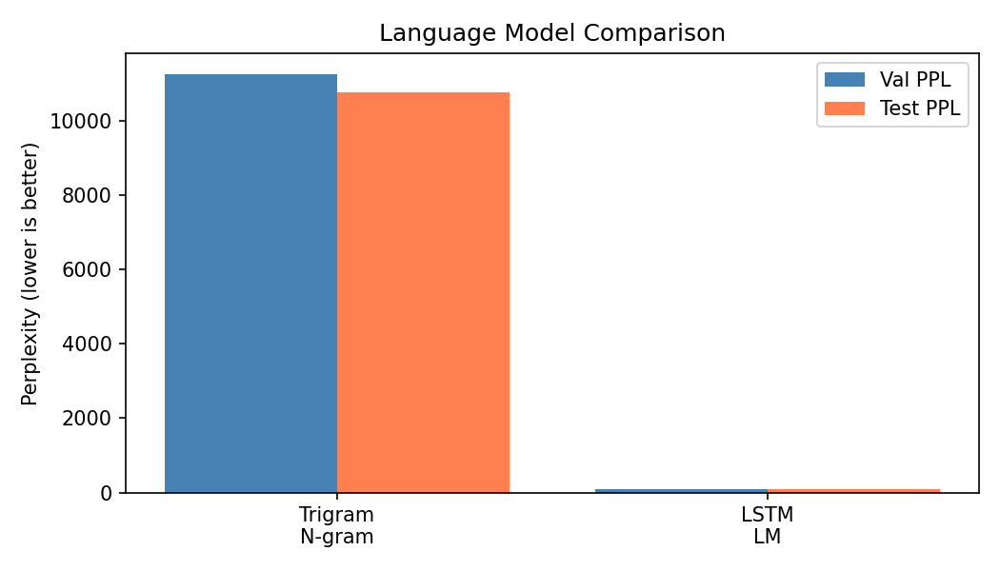

# NLP task benchmarks: classical vs. neural vs. pre-trained

[](#how-to-run)
[](#how-to-run)
[](#how-to-run)
[](report/main.pdf)
[](LICENSE)

**Ümit Arslan** · İzmir Institute of Technology · CENG 467 Natural Language Understanding and Generation, take-home midterm (May 2026)

Five end-to-end NLP experiments, one per task. Each pits a classical or from-scratch neural baseline against a pre-trained transformer on a standard benchmark, following the same recipe every time: dataset EDA → preprocessing → training or inference → metrics → error analysis → discussion. Everything ran on a free Google Colab T4 GPU with a fixed seed (42). The written report with all tables and figures is [`report/main.pdf`](report/main.pdf).

## Results at a glance

| # | Task | Dataset | Models compared | Headline result |
|---|---|---|---|---|
| Q1 | Sentiment classification | IMDb (50K reviews) | TF-IDF + logistic regression · BiLSTM · DistilBERT | DistilBERT **91.3 %** accuracy; TF-IDF + LR a close 89.4 % at a tiny fraction of the training cost |
| Q2 | Named entity recognition | CoNLL-2003 | BiLSTM-CRF · BERT-base-cased | BERT **F1 0.911** vs. 0.685 |
| Q3 | Summarization | CNN/DailyMail (500 test articles) | TextRank (extractive) · BART-large-cnn (abstractive) | BART **ROUGE-1 0.444** / BERTScore 0.881 vs. 0.342 / 0.860 |
| Q4 | Machine translation EN→DE | Multi30k | Seq2Seq + Bahdanau attention (from scratch) · MarianMT (opus-mt-en-de) | MarianMT **BLEU 36.2**; the from-scratch model trained on 29K pairs failed to converge (BLEU 0.0) |
| Q5 | Language modeling | WikiText-2 | Trigram + Laplace smoothing · 2-layer LSTM with weight tying | LSTM **test perplexity 88.6** vs. 10,753 |

The pattern repeats across all five tasks: pre-training wins, but the size of the gap and the price paid for it differ a lot by task.

## Task notes

### Q1 · Representation learning for text classification

Three representations of the same reviews: a sparse bag of 50K uni- and bigrams (TF-IDF, sublinear TF) feeding logistic regression; a 2-layer BiLSTM over randomly initialised 100-d embeddings; and `distilbert-base-uncased` fine-tuned for 3 epochs in fp16. A preprocessing ablation produced the most interesting result: the *raw whitespace-split* text beat every cleaning step, because lowercasing erases shouted sentiment (*AWFUL*, *BRILLIANT*) and stopword lists throw away *not* and *never*. The DistilBERT error analysis finds the usual suspects: sarcasm, mixed sentiment, and a positive idiom early in the review overshadowing the verdict at the end.



### Q2 · Named entity recognition

BIO tagging on CoNLL-2003 with the first-subword labelling convention (continuation word-pieces masked with −100). The BiLSTM-CRF learns tag-transition constraints through its CRF layer (`pytorch-crf`); BERT-base-*cased* is used because capitalisation is one of the strongest signals for entities, and it wins by 23 F1 points without any explicit decoding constraints. Remaining errors are mostly boundary slips (*New York City* → `B-LOC B-LOC I-LOC`), type confusion for ambiguous names such as *Washington*, and missed rare `MISC` entities.



### Q3 · Summarization

TextRank (TF-IDF cosine sentence graph + PageRank, top-3 sentences, via `sumy`) against `facebook/bart-large-cnn` run in inference mode with beam search. The common expectation that extractive methods win on ROUGE does not hold here: BART was fine-tuned on this very corpus, so its output mirrors the style of the reference highlights. The qualitative analysis shows the flip side: TextRank is always faithful to the source, while BART occasionally hallucinated a number or a name.



### Q4 · Machine translation (EN→DE)

A from-scratch seq2seq model (2-layer bidirectional GRU encoder, Bahdanau additive attention, label smoothing, teacher forcing) versus `Helsinki-NLP/opus-mt-en-de`. The from-scratch model is reported as the negative result it was: trained on the 29K sentence pairs of Multi30k for 15 epochs it never converged (perplexity ≈ 437) and produced degenerate output, while MarianMT, pre-trained on roughly 60M parallel sentences, translates fluently (BLEU 36.2, chrF 64.3, METEOR 0.67). BERTScore could not be computed for the German target in this run.



### Q5 · Language modeling

A trigram model with add-one smoothing over a 29.6K-word vocabulary against a 2-layer LSTM (256-d embeddings and hidden state, dropout 0.5, weight tying, gradient clipping). Perplexity drops from 10,753 to 88.6 on the test split. Generated samples show why: the trigram is locally grammatical for two or three words and then loses the thread, while the LSTM keeps topic and syntax for 5–10 words. A small GPT-2 would reach a perplexity of roughly 20–30 on the same data.



## How to run

Each `Q*/` folder holds one self-contained notebook. Open it in Colab, set **Runtime → Change runtime type → T4 GPU**, and run all cells; the first cell installs the dependencies.

| Notebook | Open |
|---|---|
| Q1 – Text classification | [](https://colab.research.google.com/github/umitarslann9/nlp-task-benchmarks/blob/master/Q1_Text_Classification/Q1_Text_Classification.ipynb) |
| Q2 – NER | [](https://colab.research.google.com/github/umitarslann9/nlp-task-benchmarks/blob/master/Q2_NER/Q2_NER.ipynb) |
| Q3 – Summarization | [](https://colab.research.google.com/github/umitarslann9/nlp-task-benchmarks/blob/master/Q3_Summarization/Q3_Summarization.ipynb) |
| Q4 – Machine translation | [](https://colab.research.google.com/github/umitarslann9/nlp-task-benchmarks/blob/master/Q4_Machine_Translation/Q4_Machine_Translation.ipynb) |
| Q5 – Language modeling | [](https://colab.research.google.com/github/umitarslann9/nlp-task-benchmarks/blob/master/Q5_Language_Modeling/Q5_Language_Modeling.ipynb) |

Training times measured on the T4: TF-IDF + LR under 2 minutes, BiLSTM about 20 minutes, DistilBERT about 30 minutes (Q1); the LSTM language model 15–20 minutes (Q5). Datasets are downloaded through 🤗 Datasets on first run.

The notebooks are committed **without cell outputs** to keep the repository small; the numbers and figures above come from the report, which was produced from these runs. Local alternative: any Python 3.10+ environment with `torch`, `transformers`, `datasets`, `scikit-learn`, `nltk`, `seqeval`, `pytorch-crf`, `sumy`, `rouge-score`, `bert-score`, `sacrebleu`, `matplotlib`, `seaborn`.

## Repository structure

```
nlp-task-benchmarks/
├── Q1_Text_Classification/Q1_Text_Classification.ipynb
├── Q2_NER/Q2_NER.ipynb
├── Q3_Summarization/Q3_Summarization.ipynb
├── Q4_Machine_Translation/Q4_Machine_Translation.ipynb
├── Q5_Language_Modeling/Q5_Language_Modeling.ipynb
├── scripts/                      # builders that generate the notebooks programmatically
├── report/
│   ├── main.pdf                  # the written report
│   ├── main.tex, sections/       # LaTeX source, one file per question
│   └── figures/                  # every plot used in the report and in this README
└── LICENSE
```

## License

[MIT](LICENSE) © 2026 Ümit Arslan. Datasets and pre-trained models belong to their respective authors and are used under their own licenses.
